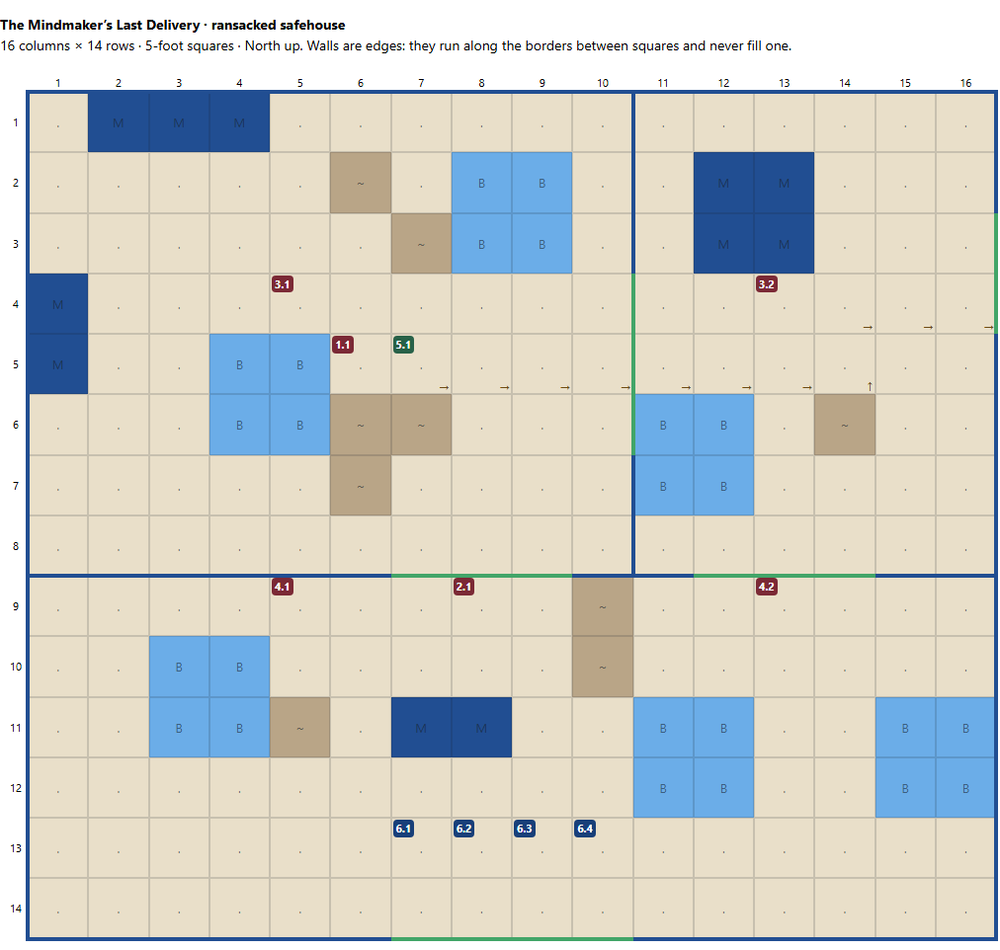

# The Mindmaker’s Last Delivery — Safehouse Tactics (v2, edge walls)

**Map:** 16 columns × 14 rows; 5-foot squares. Walls are blue lines on the edges between squares (and around the building); green line segments are the broad double doors. No square is spent on a wall. Red markers are enemies, green is Grappa, and blue marks the party’s starting squares. **B** = low furniture or crates (partial cover and difficult terrain); **M** = tall cupboards or crate stacks (impassable and block sight); **~** = scattered belongings (difficult terrain). Arrows show the extraction route.

The enemies defend two approaches to Grappa: the records-room opening and the storeroom shortcut to the carriage. They fall back as the trolley advances rather than defending their starting positions to the death.

Coordinates are (column, row), with north at the top of the 16 × 14 map. They are the same squares as in the first version. The north wall of the common room lies between rows 8 and 9; the wall between the two northern rooms lies between columns 10 and 11.

## 1.1 — Extraction Bruiser: Move the Prisoner

**Starts at (6,5), beside Grappa at (7,5).**

- Prioritizes **Haul**, taking Grappa east through the broad connecting doors between **(10,4–6)** and **(11,4–6)**, then across the storeroom toward the rear doors in the east wall.
- Stays beside or behind the trolley, treating it as an objective to protect rather than as cover.
- If intercepted, uses **Slaver’s Tangle** to immobilize the nearest obstacle and hinder their melee attacks. Spending that standard action means losing that round’s hauling opportunity unless someone else takes over.
- Calls for a lookout to haul while it fights. If nobody can replace it, it keeps moving whenever an opening appears rather than trading blows.
- Does not detour to collect papers. Getting Grappa into the carriage takes priority.

## 2.1 — Gang Blade: Delay the Direct Rescue

**Starts at (8,9), directly in front of the records-room opening.**

- Engages anyone approaching the opening at **columns 7–9** in the north wall, marking them with its saber.
- Positions to threaten someone moving through the opening without pretending it can block all three squares.
- Uses **Advantageous Jab** when a marked enemy within melee reach attacks someone else. It cannot use the jab merely because someone moves away.
- Cooperates with the western lookout to gain combat advantage. A successful charge from the lookout can expose a target to **Duelist’s Poise**, allowing the Blade to immobilize it on a hit.
- If bypassed, withdraws into the records room and fights around the scattered papers, protecting access to Grappa.
- Once the trolley enters the storeroom, follows through the connecting doors to become its rear guard. It abandons anyone who stays behind in the common room.

## 3.1 — Western Pistol Hunter: Cover the Records Room

**Starts at (5,4), north of the low furniture at (4–5,5–6).**

- Fires over the low furniture at rescuers entering through the records-room opening.
- The solid north wall limits its initial sight into the common room. It waits for a visible target or repositions; it cannot shoot through the wall.
- Uses **Trapping Net** against someone who closes within **3 squares**, especially a rescuer slipping past the Blade toward Grappa.
- Reloads with a minor action while maintaining distance. If approached from around the furniture, retreats toward the connecting doors instead of remaining trapped behind its firing position, using the spilled chests at **(8–9,2–3)** for cover on the way.
- After Grappa leaves the records room, withdraws into the storeroom and covers pursuit through the connecting doors.
- Carries the satchel of seized writings. It keeps the satchel while fleeing but does not spend combat actions searching for more documents.

## 3.2 — Eastern Pistol Hunter: Protect the Escape Route

**Starts at (13,4), inside the storeroom, south of the tall stacks.**

- Watches the storeroom opening at **columns 12–14** in the south wall, firing at anyone attempting to bypass the records-room fight.
- Repositions around the low crates at **(11–12,6–7)** to gain cover when useful, while preserving a firing lane.
- Saves **Trapping Net** for someone closing within **3 squares**, particularly a rescuer heading toward the rear doors to bar them.
- Can turn to fire through the connecting doors if the direct pursuit threatens the hauler, but doing so leaves the southern approach less closely watched.
- The stacks hide the lane along row 1 from where it starts. If a rescuer vanishes behind them, it steps to **(14,3)** to fire down the lane rather than waiting for them to appear at the doors.
- Keeps the trolley’s path clear. It does not stand in a doorway or escape square that the hauler needs.
- Retreats through the rear doors after Grappa is loaded, covering the final withdrawal if possible.

## 4.1 — Western Clan Lookout: Support the Blade

**Starts at (5,9), in the common room.**

- Moves toward the records-room opening to support the Blade rather than charging alone into the party.
- Charges an exposed pursuer when a legal charge is available. A hit makes that target grant combat advantage, setting up the Blade’s immobilization trait.
- Otherwise seeks a flank or threatens someone trying to skirt the Blade through another part of the opening.
- Follows the fight into the records room as the kidnappers withdraw.
- Becomes the preferred replacement hauler if it can reach Grappa. Doing so consumes its standard action and exposes a fragile **1-HP** enemy.

## 4.2 — Eastern Clan Lookout: Contest the Shortcut

**Starts at (13,9), in front of the storeroom opening.**

- Challenges anyone heading through the eastern opening toward the carriage.
- Uses the edges of the opening and nearby furniture, including the luggage at **(15–16,11–12)**, to make an interceptor engage or maneuver around it; it cannot seal the entire opening.
- Charges when an opening presents itself, then yields ground into the storeroom rather than remaining isolated in the common room.
- Pressures someone caught in the eastern gunman’s net, without assuming the gunman gains the Blade’s immobilization ability.
- Takes over hauling if the bruiser is disabled and it is the nearest available enemy.
- If someone bars the rear doors, it can attempt to break the bar while the gunman covers it, leaving the bruiser free to handle Grappa.

## Shared Priorities

**Extract Grappa → delay immediate interceptors → preserve the seized writings → escape.**

Only **one Haul action can occur per round**, regardless of who performs it. The trolley is loaded when a Haul ends at **(16,3)** or **(16,4)**. Closing an internal door can delay pursuit, but the kidnappers should do so only after Grappa and their retreating allies have passed through.

Once Grappa is freed and **two standard enemies are down**, survivors flee with whatever papers they already carry. They surrender if cornered.
