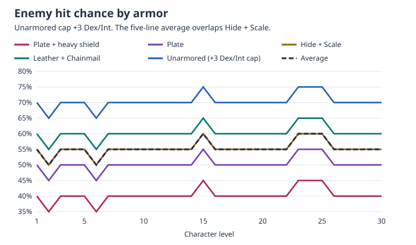

# Armor overhaul (2026-11-22)

This note records the armor design agreed so far so a new session can pick up the work. The armor data, Character Builder, and rulebook still use the current rules. Wait for the user's go-ahead before changing armor data or how the builder calculates AC. Delete this note after the change ships.

On 2026-11-22 the user called this version "the fix we were looking for". This design replaces the earlier armor kits. Each kit had a fixed level 1 AC, and Dexterity or Intelligence only determined whether a character qualified. Ability points did not add to AC under that design.

## Goal

Use a simple armor rule to keep the average monster's chance to hit a player at about 55% from level 1 through 30. Limit how much ability points can add to armor class (AC).

## The design

**AC = armor value + Dex/Int points (up to the armor's cap, light armor only) + half level (rounded down) + magic enhancement + the added bonus.**

| Armor | AC at level 1 | Dex/Int cap | Penalties |
| --- | --- | --- | --- |
| Cloth (unarmored) | 10 + Dex/Int | +3 | None |
| Leather | 12 + Dex/Int | +3 | None |
| Hide | 13 + Dex/Int | +3 | None |
| Chainmail | 15 | Dex/Int do not count | -1 speed |
| Scale | 16 | Dex/Int do not count | -1 speed |
| Plate | 17 | Dex/Int do not count | -1 speed, -1 armor check |

- **Use ability points directly.** As in the current rules, use the higher of Dexterity (Dex) and Intelligence (Int). The comparison starts the main ability at +4 and a secondary at +2. Under the 2.0 schedule, elective boosts are at levels 8, 14, and 28, with a boost to all abilities at level 21.
- **Unarmored (Cloth), Leather and Hide** each add up to +3 AC from Dex or Int.
- **Heavy armor has a fixed armor value.** Chainmail gives 15, Scale gives 16, and Plate gives 17. The design notes compare these with light armor on a character whose main ability is Dex or Int. The table shows that Leather and Hide reach 15 and 16, while Cloth reaches 13. No light armor in the table reaches 17.
- **In armor bonus terms** (AC = 10 + bonus): Cloth 0, Leather +2, Hide +3, Chainmail +5, Scale +6, Plate +7. The light armor bonuses match standard 4e. Each heavy armor bonus is 1 lower than its standard value (+6, +7, and +8 respectively). The speed and armor check penalties come from the earlier kit table and have not been revisited.
- **Features that swap the AC stat keep working** (Barbarian Agility with Strength, Primal Guardian and the Shaman's World Speaker spirit with Constitution): the swapped stat is the one counted up to the cap.

### When the extra AC bonus increases

**You gain +1 AC at levels 5, 9, 13, 17, 19, 25, 27 and 29** (+8 total), for every armor.

- The calculation assumes characters wear enchanted armor and follow the Player's Handbook (PHB) enhancement schedule. The armor grants +1 at level 2, +2 at 6, +3 at 11, +4 at 16, +5 at 21, and +6 at 26.
- Monster attack rises 1 per level, so AC should too. Half level adds AC on even levels and enhancement on 2, 6, 11, 16, 21 and 26. The extra bonus increases on odd levels. The level 19 increase keeps AC on pace with monster attack through level 22. No extra AC increase overlaps an enhancement increase. No level gains more than 2 AC, so the hit chance changes by at most 5 percentage points between levels.
- A tier bonus to AC is not part of this (the rulebook gives +1/+2/+3 by tier to attack, Fortitude, Reflex and Will only).

### Fortitude, Reflex, and Will

Use the higher ability in each pair as the defense's ability contribution.

| Defense | Ability contribution |
| --- | --- |
| Fortitude | Higher of Strength and Constitution |
| Reflex | Higher of Dexterity and Intelligence |
| Will | Higher of Wisdom and Charisma |

Each defense equals its class base + the higher ability + half level (rounded down) + magic neck enhancement + the built-in tier bonus (+1/+2/+3). The light armor +3 cap applies only to AC.

In the earlier shieldless comparison (with the extra AC at level 21) using the [2.0 ability progression](ABILITY_UPDATE.md), a same-level monster attacks AC at level + 5 and the other defenses at level + 3. Using the higher ability raises the average hit chance against Fortitude, Reflex, and Will from 51.0% to 56.0% across levels 1–30. The average absolute gap from Scale AC drops from 5.37 to 2.72 percentage points. For Hide with +2 Dex or Int at level 1 and a boost at level 8, the gap drops from 6.54 to 3.89 points. The comparison starts the three ability pairs at 4/0, 2/1, and 1/1 and uses elective boosts on the stronger abilities in the first two pairs.

## Results

The chart assumes a heavy shield adds +2 AC to Plate. The average weights each of the five plotted lines equally and overlaps Hide and Scale at every level.

The calculation sets monster attack to level + 5. Calculate hit chance as `(level + 26 - AC) / 20`, with a minimum of 5% and a maximum of 95%. An earlier check against 4,770 published monsters found a mean difference of +0.01. The rulebook's levels 11–30 are provisional, so the paragon and epic results are estimates.

The table shows AC at levels 1 and 30 for a character whose main ability is Dex or Int. The three hit chances are the averages for levels 1–10, 11–20, and 21–30, in that order. Armors with the same AC share a row.

| Armor | AC L1 / L30 | Hit chance (%) |
| --- | --- | --- |
| Plate | 17 / 46 | 49 / 50.5 / 51.5 |
| Hide and Scale | 16 / 45 | 54 / 55.5 / 56.5 |
| Leather and Chainmail | 15 / 44 | 59 / 60.5 / 61.5 |
| Cloth (unarmored) | 13 / 42 | 69 / 70.5 / 71.5 |

- The four lines are parallel. Plate, Hide/Scale and Leather/Chainmail are 5 percentage points apart. Unarmored is 10 percentage points above Leather/Chainmail.
- A +2 secondary reaches the cap at level 8 if chosen for the first elective boost, level 14 if first chosen then, or level 21 from the boost to all abilities. Before reaching the cap, its armor is 1 AC lower and gets hit 5 percentage points more often.
- A main Dex/Int character reaches the +3 cap in all three categories at level 1.
- Small 5-point dips at levels 2, 6, 16 and 26 come from half level and enhancement landing together; the enhancement schedule is fixed.

## Confirmed armor decisions

- Drop the Mage Armor option from the earlier armor-kit proposal.
- Keep the listed armor values and penalties. Secondary Dex or Int can eventually reach the same light armor cap as a main ability. Capped Leather and Chainmail both give 15 AC, and Chainmail has a -1 speed penalty.
- Keep existing armor proficiencies, including class access, the Armor Proficiency feat, and proficiency-granting features.
- Use the existing shield rules. A character can pair a shield with any armor, subject to the existing rules for using the shield.

## Class comparisons

These shieldless examples use Barbarian Agility (Strength), Primal Guardian (Constitution), and World Speaker Spirit (Constitution). The Barbarian starts at +4 Strength. The Druid and Shaman start at +2 Constitution and choose it at every elective boost. All use the same enhancement schedule and same-level monster benchmark.

| Build | 2.0 AC L1 / L30 | 2.0 hit chance by tier | Nominal 4e AC L1 / L30 | Nominal 4e hit chance by tier |
| --- | --- | --- | --- | --- |
| Barbarian (Hide, Str +4) | 16 / 45 | 54% / 55.5% / 56.5% | 17 / 42 | 51.5% / 59% / 66% |
| Druid (Hide, Con +2) | 15 / 45 | 57.5% / 55.5% / 56.5% | 15 / 40 | 61.5% / 69% / 76% |
| Shaman (Leather, Con +2) | 14 / 44 | 62.5% / 60.5% / 61.5% | 14 / 39 | 66.5% / 74% / 81% |

The nominal 4e baseline uses the same base armor and equivalent modifier progression, with the full ability modifier and without the 2.0 extra AC schedule. It excludes masterwork armor and other situational or item bonuses.

## What to do after approval

1. Change the armor bonuses in `src/modern4e/content/equipment/equipment.json` to the values above (Cloth 0, Leather +2, Hide +3, Chainmail +5, Scale +6, Plate +7), add the +3 Dex/Int cap for unarmored (Cloth), Leather and Hide, then regenerate with `python3 src/modern4e/scripts/equipment_content.py` and `python3 src/character-builder/content/build.py --modern-equipment --check`, and check the production-generated packages under `src/character-builder/content/production-generated/modern4e.equipment/`.
2. Change `src/character-builder/shared/src/commonMain/kotlin/dev/modern4e/builder/DefenseRules.kt`: cap the ability contribution per armor and add +1 at each of levels 5, 9, 13, 17, 19, 25, 27, and 29. Update `shared/ENGINE.md`.
3. Update tests that hard-code armor values (`ProductionContentPackagesTest.kt`, `SharedContentAcceptanceTest.kt`, `DefenseRulesTest.kt`, `EquipmentDefenseTest.kt`, fixtures under `shared/fixtures`, `content/samples.py`) and add coverage for the caps and the added bonus.
4. Update the builder and rulebook formulas for Fortitude, Reflex, and Will to use the higher ability and add half level. Test ties, advancement, and rounding. Update `FEATURES.md`, `tests/README.md`, and the rulebook armor and AC rules, then run `npm run typst:compile` and check the affected pages.
5. Remove the queued item from memory (`project-armor-ac-todo.md`) and delete this file.
